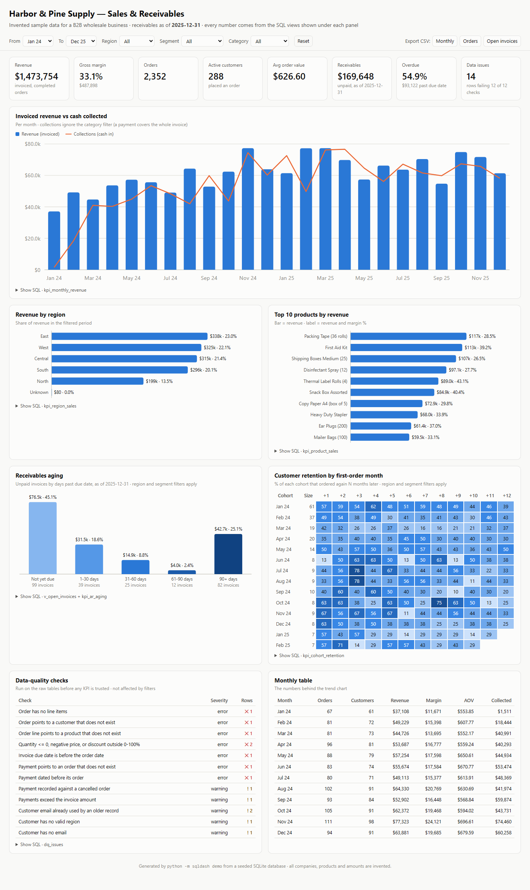

# SQL → Business Dashboard

Turn raw sales, invoice and payment tables into a filterable KPI dashboard and Power BI-ready
files — with every number coming from readable SQL views, and data-quality checks run first.

Built on an **invented** B2B wholesale business ("Harbor & Pine Supply" does not exist). Swap in
your own tables and the same SQL produces your numbers.



<sub>Phone view: [examples/dashboard-mobile.png](examples/dashboard-mobile.png) ·
Live file: [examples/dashboard.html](examples/dashboard.html) (download and open in any browser, works offline)</sub>

## The problem this solves

Many small and mid-size businesses run reporting like this:

- Someone exports sales and payments to Excel every month and rebuilds the same pivot tables by hand.
- Two people report two different revenue figures, and nobody can say which formula is right.
- No one sees which customers owe money 60 or 90 days past due until cash gets tight.
- Bad rows (an order for a deleted customer, a payment keyed twice) quietly change the totals.

This project replaces that with **SQL views as the single definition of each KPI**, a
**data-quality report** that names the exact bad rows, and a **dashboard** that anyone can filter.

## What you get

| Piece | What it is |
|---|---|
| `sql/schema.sql` | 7 tables: regions, customers, products, orders (= invoices), order_items, payments, report_params |
| `sql/views.sql` | 10 KPI views: revenue trend, receivables aging, cohort retention, products, regions, headline tiles |
| `sql/dq_checks.sql` | 12 data-quality rules, each returning the offending record IDs |
| `sql/generated/` | The same scripts for **SQL Server** and **PostgreSQL** |
| `examples/dashboard.html` | One self-contained HTML file: filters, 8 KPI tiles, 5 charts, tooltips, CSV export, "Show SQL" under each chart |
| `examples/powerbi/` | Star-schema CSVs (3 dimensions + 3 facts) and [POWERBI.md](POWERBI.md), a step-by-step loading guide with DAX measures |

## Demo in 3 commands

Needs Python 3.11+. No packages to install; it uses only the standard library.

```bash
git clone <this-repo-url> sql-business-dashboard
cd sql-business-dashboard
python -m sqldash demo
```

`demo` builds `build/business.db` from seed 42 (about 2,450 orders, 5,200 invoice lines and 2,250
payments), prints the KPIs and data-quality report, writes the dashboard and Power BI CSVs into
`examples/`, and opens the dashboard. It takes about 2 seconds on a laptop. `make demo` does the same.

Run the tests (offline, about 5 seconds):

```bash
python -m pip install pytest
python -m pytest -q
```

## The KPIs and their SQL

Every chart in the dashboard has a **Show SQL** link with the full view. The core logic of each:

**1. Revenue vs cash collected per month** (`kpi_monthly_revenue`): invoiced revenue from
completed orders next to payments actually received, so a sales spike that never turns into cash
is visible.

```sql
WITH sales AS (
    SELECT month_key, COUNT(*) AS orders, COUNT(DISTINCT customer_id) AS active_customers,
           SUM(order_revenue) AS revenue, SUM(order_revenue - order_cost) AS gross_margin
    FROM v_orders WHERE status = 'Completed' GROUP BY month_key
), cash AS (
    SELECT @MONTH(paid_on) AS month_key, SUM(amount) AS collections
    FROM payments GROUP BY @MONTH(paid_on)
)
SELECT s.month_key, s.orders, s.active_customers, ROUND(s.revenue, 2) AS revenue, ...
FROM sales s LEFT JOIN cash c ON c.month_key = s.month_key;
```

**2. Receivables aging** (`v_open_invoices`, `kpi_ar_aging`): what each customer still owes as of
the report date, bucketed by days past the due date. Payments after the report date are ignored,
so you can re-run any past month-end.

```sql
CASE WHEN b.days_past_due <= 0  THEN 'Not yet due'
     WHEN b.days_past_due <= 30 THEN '1-30 days'
     WHEN b.days_past_due <= 60 THEN '31-60 days'
     WHEN b.days_past_due <= 90 THEN '61-90 days'
     ELSE '90+ days' END AS aging_bucket
...
SELECT aging_bucket, COUNT(*) AS open_invoices, ROUND(SUM(outstanding), 2) AS outstanding,
       ROUND(100.0 * SUM(outstanding) / SUM(SUM(outstanding)) OVER (), 1) AS pct_of_total
FROM v_open_invoices GROUP BY bucket_order, aging_bucket;
```

**3. Cohort retention** (`kpi_cohort_retention`): customers grouped by the month of their first
order, and the share who ordered again 1, 2, 3 … months later.

```sql
first_order AS (SELECT customer_id, MIN(order_date) AS first_date FROM completed GROUP BY customer_id),
activity AS (
    SELECT DISTINCT f.customer_id, @MONTH(f.first_date) AS cohort_month,
           @MONTH_INDEX(c.order_date) - @MONTH_INDEX(f.first_date) AS months_since_first
    FROM first_order f JOIN completed c ON c.customer_id = f.customer_id)
SELECT a.cohort_month, a.months_since_first, s.cohort_size, COUNT(*) AS active_customers,
       ROUND(100.0 * COUNT(*) / s.cohort_size, 1) AS retention_pct ...
```

**4. Top products** (`kpi_product_sales`): units, revenue, margin and rank.

```sql
SELECT l.product_name, l.category, SUM(l.quantity) AS units,
       ROUND(SUM(l.line_revenue), 2) AS revenue,
       ROUND(SUM(l.line_revenue - l.line_cost), 2) AS gross_margin,
       RANK() OVER (ORDER BY SUM(l.line_revenue) DESC) AS revenue_rank
FROM v_order_lines l JOIN orders o ON o.order_id = l.order_id
WHERE o.status = 'Completed'
GROUP BY l.product_id, l.product_name, l.category;
```

**5. Sales by region** (`kpi_region_sales`): revenue, orders, customers and share of total. Orders
whose customer record is missing show up as region **Unknown** instead of silently disappearing,
so region totals always add up to the headline total.

**6. Headline tiles** (`kpi_headline`): revenue, gross margin %, orders, active customers, average
order value, receivables outstanding, and % overdue.

`@MONTH`, `@MONTH_INDEX` and `@DAYS_BETWEEN` are the only database-specific pieces. They expand to
`strftime` (SQLite), `CONVERT`/`DATEDIFF` (SQL Server) or `to_char`/date subtraction (PostgreSQL).
See [`sqldash/dialects.py`](sqldash/dialects.py).

### Data-quality checks (`dq_issues`)

Run before anyone trusts a KPI. Each check returns the table and record ID to fix.

| Check | Severity | Catches |
|---|---|---|
| `order_without_items` | error | Order with no line items |
| `orphan_order_customer` | error | Order for a customer that does not exist |
| `orphan_item_product` | error | Line for a product that does not exist |
| `bad_quantity_or_price` | error | Quantity ≤ 0, negative price, discount outside 0–100% |
| `due_before_order` | error | Due date before order date |
| `orphan_payment` | error | Payment for an order that does not exist |
| `payment_before_order` | error | Payment dated before its order |
| `payment_on_cancelled_order` | warning | Money received against a cancelled order |
| `overpaid_invoice` | warning | Payments exceed the invoice (often a double entry) |
| `duplicate_customer_email` | warning | Same email on two customer records |
| `missing_customer_region` | warning | Customer without a valid region |
| `missing_email` | warning | Customer without an email |

The sample data has 14 bad rows planted on purpose. The tests check that the report finds exactly
those 14 and nothing else.

## Pointing it at your own data

**Option A — CSV exports (easiest).** Export one CSV per table with these headers, then build:

| File | Columns |
|---|---|
| `regions.csv` | region_id, region_name |
| `customers.csv` | customer_id, customer_name, email, segment, region_id, created_on |
| `products.csv` | product_id, product_name, category, unit_cost, list_price |
| `orders.csv` | order_id, customer_id, order_date, due_date, status (`Completed`/`Cancelled`), channel |
| `order_items.csv` | order_item_id, order_id, product_id, quantity, unit_price, discount_pct |
| `payments.csv` | payment_id, order_id, paid_on, amount, method |

Dates as `YYYY-MM-DD`.

```bash
python -m sqldash build --from-csv path/to/your_csvs --report-date 2025-12-31 --db build/mine.db
python -m sqldash report --db build/mine.db
python -m sqldash dashboard --db build/mine.db --out build/mine.html
python -m sqldash powerbi --db build/mine.db --out build/mine_powerbi
```

**Option B — directly on SQL Server or PostgreSQL.** If your tables have different names or
columns, first create six thin views with the names above that rename your columns (for example
`CREATE VIEW orders AS SELECT InvoiceNo AS order_id, CustomerNo AS customer_id, ... FROM dbo.Invoices`),
add a one-row `report_params` table, then run `sql/generated/sqlserver/views.sql` and
`dq_checks.sql` (or the `postgres` versions). Power BI, Excel or any BI tool can then read the
`kpi_*` views directly. The HTML dashboard generator itself reads SQLite, so for Option B use
Option A's CSV route or Power BI for the visuals.

## Project layout

```
sql/                 schema, KPI views, data-quality checks (+ generated SQL Server / PostgreSQL)
sqldash/generate.py  seeded generator for the invented business (and the planted bad rows)
sqldash/db.py        build the SQLite database, load data or CSVs, install views
sqldash/kpis.py      run the views, data-quality summary
sqldash/dashboard.py build the single-file HTML dashboard
sqldash/assets/      dashboard template, CSS, chart + filter JavaScript (core.js holds the maths)
sqldash/powerbi.py   star-schema CSV export
tests/               49 offline tests; tests/fixtures/tiny.sql is the hand-checked mini dataset
examples/            generated dashboard, screenshots, Power BI CSVs
```

## How it is tested

- **KPIs against hand-worked answers.** `tests/fixtures/tiny.sql` holds 4 customers and 8 orders.
  Every KPI view is compared with values worked out by hand (the arithmetic is in the test comments).
- **Data quality.** Clean data passes all 12 checks. Each check then gets one planted bad row and
  must report exactly that row.
- **Dashboard equals SQL.** The dashboard's filter maths (`core.js`) is run in Node.js on the full
  sample data and compared with the SQL views, unfiltered and with region, segment, date and
  category filters. (These two tests are skipped if Node.js is not installed.)
- **Determinism.** Same seed gives byte-identical data; a different seed gives different data.
- **Exports.** Power BI CSV totals match SQL, and every fact key exists in its dimension.
  Loading the fixture back from CSV gives identical KPIs.
- **SQL dialects.** Macro expansion is checked for all three databases, and the committed
  SQL Server/PostgreSQL scripts must match a fresh export.

## Honest status

- This is a portfolio and demo project. All data is invented; there are no real users or clients
  behind any number shown.
- The SQLite path is fully tested. The SQL Server and PostgreSQL scripts are generated from the
  same SQL and their expansion is unit-tested, but **they have not yet been run against a live
  SQL Server or PostgreSQL instance** in this repo's tests.
- The dashboard embeds its data in the HTML file (about 300 KB for 2,450 orders). That suits up to
  tens of thousands of orders. For millions of rows, use the Power BI route or a server-backed
  dashboard. The file has no login, so don't publish it with real customer data.
- Retention cohorts and receivables aging use region and segment filters only; the notes on each
  chart say which filters apply.

## Who built it

Specified, reviewed and tested by **Asad Ali**: 10+ years in banking IT (SQL Server, regulatory
and operational reporting, data migration, UAT). The code was written with AI coding agents
(Claude Code) working from his spec, with every KPI checked against hand-computed values.

MIT licensed. See [LICENSE](LICENSE).
